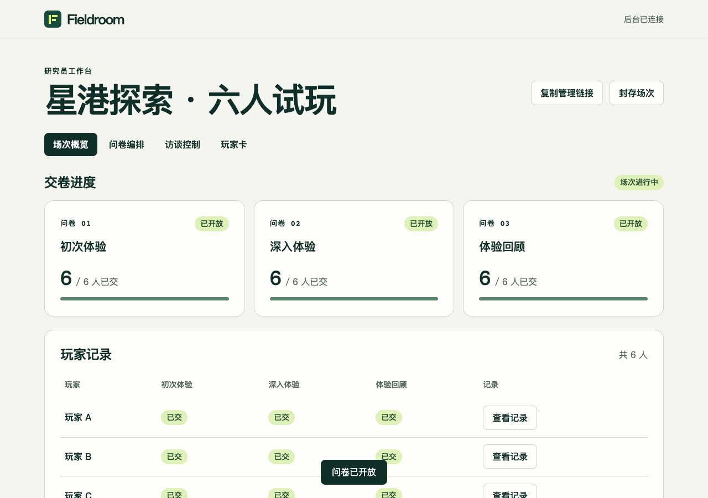
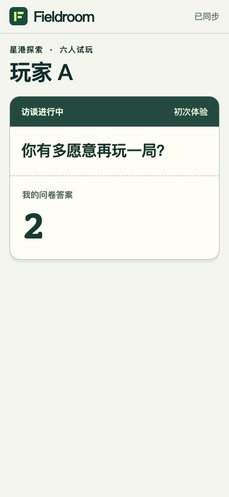

# 首版验收

2026-11-21 在 macOS、Python 3.14、桌面 Chrome 157 上运行。题目、场次和玩家均为虚构。研究员使用单独的管理会话，六位玩家分别使用隔离浏览器上下文，换机时另开第七个玩家上下文。

| 检查 | 实测结果 |
|---|---|
| 分卡与交卷 | 从页面上渲染的六张二维码逐张解码，其地址分别进入 A–F 六位玩家的会话。研究员逐份开放，六人共交 18 份问卷、提交 6 条体验问题。后台三份均显示 6/6。 |
| 跨卷群访 | 先向六人展示第三份问卷中的题目，再跳到第一份的「你有多愿意再玩一局？」。A–F 设备分别显示 2、4、3、5、1、4。 |
| 单访与未交卷 | 单独选中尚未交卷的玩家时，该玩家显示「暂无已提交答案」，未选中的设备仍停在填写页。 |
| 访谈补充 | A 口头改为 4 分，主持人追加原因。后台出现补充，A 的答卷仍为 2 分。 |
| 自然保存 | 玩家写到一半时触发访谈，草稿同步后才跳题。结束访谈后恢复原文字和输入位置。阻断写请求再刷新，恢复网络后仍能补传。中文输入法流程使用合成浏览器事件验证。 |
| 换机与旧草稿 | A 的旧设备断网并产生未同步的 1 分。新设备用原卡进入正在进行的访谈，取回已保存的 2 分及答卷，之后直接改为 5 分。旧设备重连退出，后台保持 5 分并保留原记录。 |
| 收场 | 结束访谈后仍可填改；封存后问卷只读。重新开放后，原卡恢复编辑。 |
| 后台编辑 | 验证新增、移除、调序及修改已开放题目，两名管理者同时编辑时识别冲突；原题快照与删除前的已交答案可回看。已用超过 50 条的修改历史验证翻页。 |
| 地址与设备 | 服务实际监听局域网端口，主机通过本机 Wi-Fi 网卡地址读取首页与接口。二维码在浏览器中完成图像解码。**跨设备同一 Wi-Fi 连通、物理手机相机扫码和实体机型兼容性待现场实测。** |

六人浏览器流程可按 README 重跑；九项服务回归覆盖设备权限、跨场次隔离、写入重试、历史与分页、未交访谈、校验和分享地址选择。额外的同机请求测量使用六个并发客户端，每种接口 60 个请求。已有 10,002 条历史记录时，版本检查、个人状态和后台单人详情的第 95 百分位分别约为 3、4、12 毫秒。此项只测本机服务响应，现场同步还受局域网、浏览器调度和约一秒的版本检查间隔影响。

