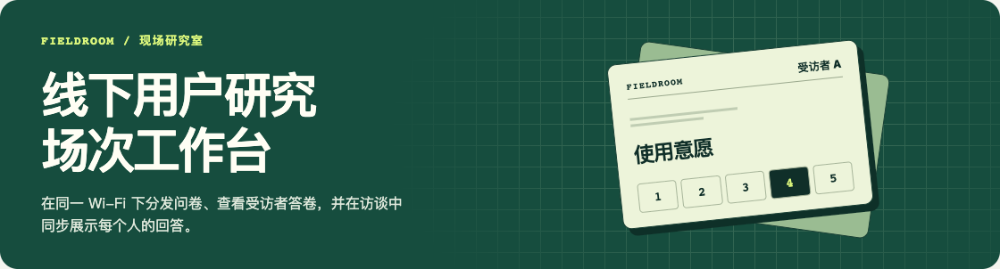
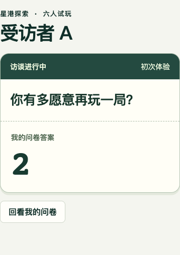
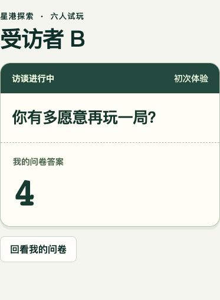
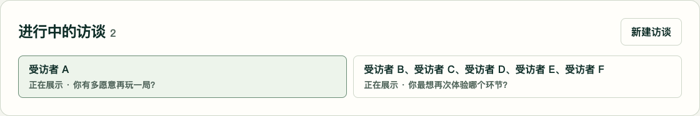
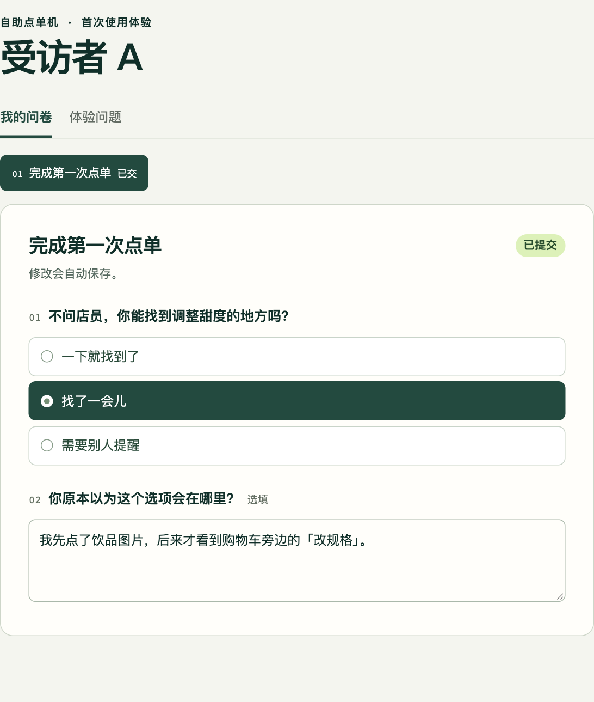

# Fieldroom · 现场研究室

Fieldroom 给做线下用户研究的人用。受访者用手机扫自己的卡，体验一轮，填一份问卷。研究员能马上看到谁交了、每个人写了什么。到了访谈环节，主持人选一道题，每个人的屏幕上都会出现**同一道题和自己当时的回答**。

## 游戏试玩：同样玩了一局，为什么一个人给 2 分，另一个给 4 分？

六位玩家试玩《星港探索》。第一局结束后，研究员开放第一份问卷；玩家交完继续玩，遇到问题可以随手记。中途换手机，扫原来的卡就能找回已保存的答案。

访谈时，主持人跳回「你有多愿意再玩一局？」。A 看见自己给的 2 分，B 看见自己的 4 分。如果 A 说“第二局弄懂连招以后，我想改给 4 分”，主持人可以把这句话记在 A 名下，以后还能查到最初的 2 分。

| A 的屏幕 | B 的屏幕 |
| --- | --- |
|  |  |

也可以分开聊。下面这场里，一位主持人单独问 A 为什么只给了 2 分，另一位请 B–F 聊最想再体验哪个环节。点进任意一组就能给这组切题或结束访谈。

## 自助点单机：顾客是在哪一步卡住的？

请受访者试着点一杯半糖饮料，点完问一句：“不问店员，你能找到调整甜度的地方吗？”这位受访者选了“找了一会儿”，又写下自己先点了饮品图片。研究员可以接着问：“你点图片时，原本期待看到什么？”

以上截图来自用虚构题目和受访者跑通的本地场次。

## 怎么开始？

在研究员的电脑上启动 Fieldroom，让手机、平板或其他电脑连同一个 Wi-Fi。在工作台创建场次，就有三份游戏试玩示例问卷。可以直接试填，也可以把题目换成自己的。答卷保存在运行 Fieldroom 的电脑上。

[安装和启动](docs/setup.md) · [已启动，打开本机工作台](http://127.0.0.1:8765) · [现场使用手册](docs/field-guide.md)

想接着开发，可以看[代码和测试说明](docs/development.md)以及[六人试玩验收记录](docs/acceptance.md)。
